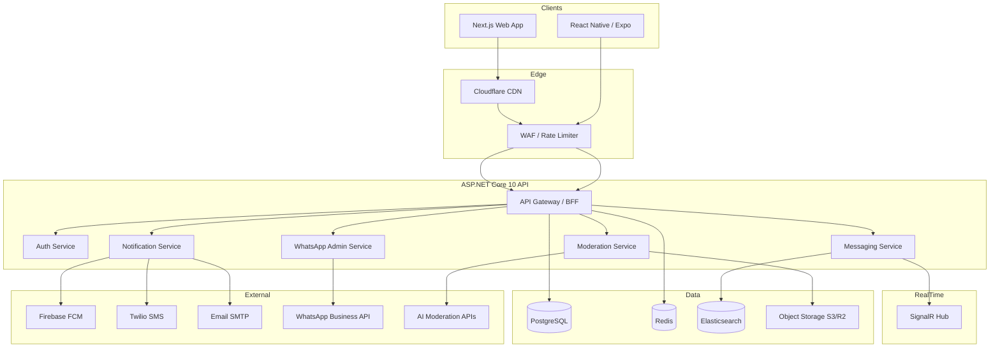
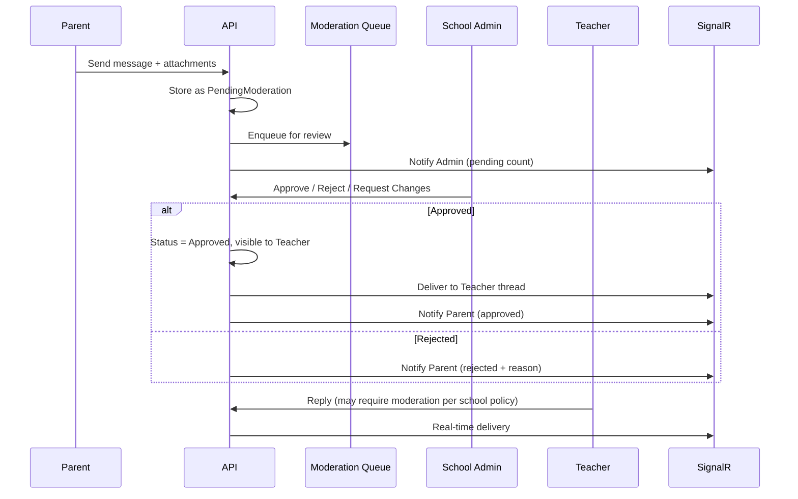
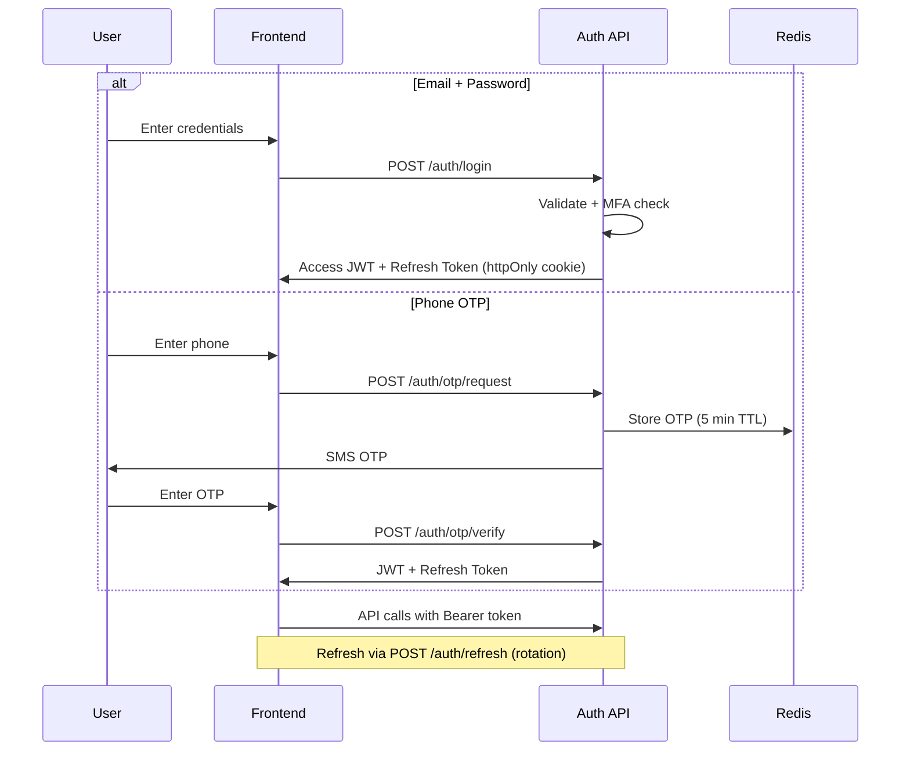
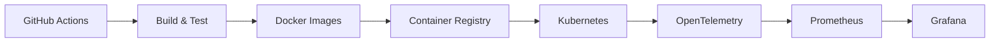

# SchoolCom — System Architecture

## Executive Summary

SchoolCom is a multi-tenant SaaS platform enabling secure parent–teacher communication with mandatory admin moderation, real-time messaging, and enterprise-grade security. The architecture follows Clean Architecture on the backend, feature-sliced design on the frontend, and shared domain logic between web and mobile.

---

## High-Level Architecture



---

## Multi-Tenancy Model

| Strategy | Implementation |
|----------|----------------|
| **Isolation** | Row-level `TenantId` (SchoolId) on all tenant-scoped entities |
| **Routing** | Subdomain (`school-a.schoolcom.com`) or custom domain |
| **Branding** | Per-tenant theme config stored in `TenantSettings` |
| **Super Admin** | Cross-tenant access via explicit policy + audit trail |

**Recommendation:** Shared database with tenant discriminator (PostgreSQL RLS optional for defense-in-depth). Scales to 100K+ users with proper indexing on `(TenantId, ...)`.

---

## Database Architecture Recommendation

### Primary: PostgreSQL 16+

| Pros | Cons |
|------|------|
| ACID, JSONB for flexible metadata | Vertical scaling limits vs NoSQL |
| Excellent multi-tenant indexing | Requires DBA expertise at scale |
| Full-text search (pg_trgm) | Elasticsearch needed for advanced message search |
| Mature ecosystem, EF Core support | |

### Cache: Redis 7+

| Pros | Cons |
|------|------|
| Session, OTP, rate limiting, SignalR backplane | Memory cost |
| Sub-ms reads for hot data | Persistence configuration needed |

### Search: Elasticsearch (Optional Phase 2)

| Pros | Cons |
|------|------|
| Full-text message search at scale | Operational complexity |
| Analytics aggregations | Sync pipeline required |

### Object Storage

| Provider | Pros | Cons |
|----------|------|------|
| **AWS S3** | Industry standard, lifecycle policies | Cost at scale |
| **Cloudflare R2** | No egress fees, S3-compatible API | Smaller ecosystem |
| **Azure Blob** | Azure integration | Vendor lock-in |

**Recommendation:** PostgreSQL + Redis + Cloudflare R2 (cost-effective media) + Elasticsearch in Phase 2.

---

## Backend Clean Architecture Layers

```
SchoolCom.Api          → Controllers, SignalR Hubs, Middleware, DI
SchoolCom.Application  → CQRS (Commands/Queries), DTOs, Validators, Interfaces
SchoolCom.Domain       → Entities, Value Objects, Domain Events, Enums
SchoolCom.Infrastructure → EF Core, Redis, S3, External APIs, Identity
```

**Dependency Rule:** Domain ← Application ← Infrastructure ← Api

---

## Messaging Flow (Parent → Admin → Teacher)



---

## Authentication Flow



---

## Security Architecture

| Layer | Control |
|-------|---------|
| Transport | TLS 1.3, HSTS |
| Auth | JWT (15 min), Refresh rotation (7 days), MFA (TOTP) |
| AuthZ | RBAC + Policy-based (tenant scope) |
| Input | FluentValidation, parameterized queries |
| XSS | CSP headers, output encoding, React auto-escape |
| CSRF | SameSite cookies + anti-forgery for cookie auth |
| Rate Limit | Redis sliding window per IP/user |
| Audit | Immutable `AuditLog` table, Serilog structured logs |
| Media | Pre-signed URLs, virus scan hook, size/type validation |

---

## Scalability Targets

| Metric | Target |
|--------|--------|
| Concurrent users | 10,000+ per region |
| Total users | 100,000+ |
| Message throughput | 1,000 msg/sec (horizontal SignalR scale-out) |
| Availability | 99.9% SLA |

**Scale-out:** Stateless API pods, Redis SignalR backplane, read replicas for PostgreSQL, CDN for static/media.

---

## DevOps Architecture



---

## Technology Version Matrix

| Component | Version |
|-----------|---------|
| ASP.NET Core | 10.x |
| Next.js | 16.x |
| React | 20.x |
| PostgreSQL | 16+ |
| Redis | 7+ |
| Node.js | 22 LTS |
