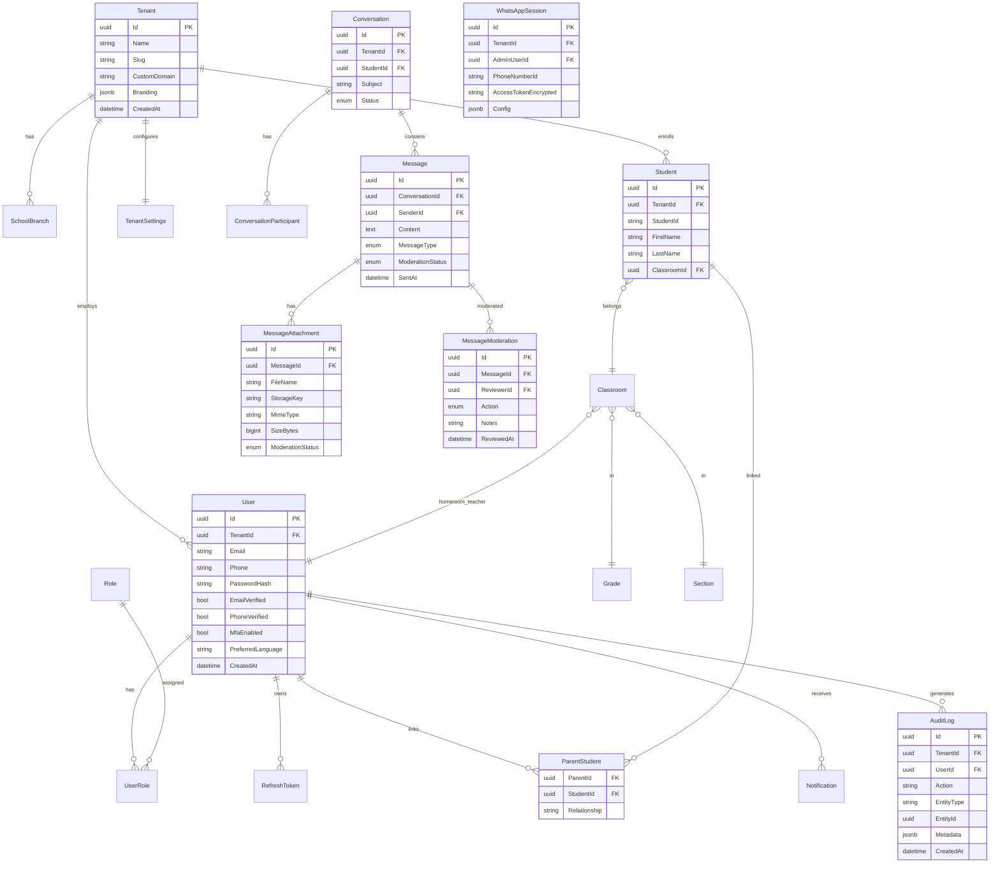

# Database Design & ERD

## Primary keys and identifiers

All entity tables use **UUID v7** (`Guid.CreateVersion7()` in .NET, PostgreSQL `uuid`) for primary keys and foreign keys.

| Choice | Rationale |
|--------|-----------|
| UUID v7 (not v4) | Time-ordered for better B-tree locality, index performance, and chronological debugging |
| Not BIGINT identity | Avoids exposing sequential record counts in URLs and APIs |
| Not snowflake / huge numeric IDs | Keeps identifiers compact, standard, and human-readable in logs |
| Application-generated | IDs are assigned on insert via EF Core value generators and interceptors (no DB sequences) |

**Timestamps:** Every table with a surrogate `Id` and all major junction tables (`UserRoleAssignments`, `ParentStudents`, `ConversationParticipants`) include `CreatedAt` and `UpdatedAt` (UTC). Demo seed data uses fixed UUIDs for stable credentials; runtime inserts use UUID v7.

**Schema changes:** Always via EF Core migrations (`dotnet ef migrations add` / automatic apply on API startup). Do not alter production schema manually.

---

## Entity Relationship Diagram



---

## Core Tables Summary

### Identity & Access

| Table | Purpose |
|-------|---------|
| `Users` | All platform users |
| `Roles` | SuperAdmin, SchoolAdmin, Teacher, Parent |
| `UserRoles` | Many-to-many user-role |
| `RefreshTokens` | JWT refresh token rotation |
| `OtpCodes` | Phone/email OTP (also cached in Redis) |
| `MfaSecrets` | TOTP secrets |

### Academic Structure

| Table | Purpose |
|-------|---------|
| `SchoolBranches` | Physical campus locations |
| `Grades` | Grade levels (K-12) |
| `Sections` | Section A, B, C |
| `Classrooms` | Grade + Section + Homeroom teacher |
| `Students` | Student records |
| `ParentStudents` | Parent-child relationships |

### Messaging

| Table | Purpose |
|-------|---------|
| `Conversations` | Thread per parent-student-teacher context |
| `ConversationParticipants` | Users in thread |
| `Messages` | Text, system, announcement |
| `MessageAttachments` | Media files with moderation status |
| `MessageModeration` | Admin review history |
| `MessageReadReceipts` | Read tracking |
| `TypingIndicators` | Ephemeral (Redis primary) |

### Notifications & Admin

| Table | Purpose |
|-------|---------|
| `Notifications` | In-app notifications |
| `NotificationPreferences` | Per-channel opt-in |
| `WhatsAppSessions` | Admin WhatsApp Business config |
| `WhatsAppMessages` | Outbound/inbound WhatsApp log |
| `AuditLogs` | Immutable audit trail |
| `Reports` | Generated report metadata |

### Tenant Configuration

| Table | Purpose |
|-------|---------|
| `TenantSettings` | Moderation rules, media limits, branding |
| `SubscriptionPlans` | Free/Pro tier limits |

---

## Indexing Strategy

```sql
-- Tenant isolation (every query)
CREATE INDEX ix_users_tenant_id ON users (tenant_id);
CREATE INDEX ix_messages_conversation_sent ON messages (conversation_id, sent_at DESC);
CREATE INDEX ix_messages_moderation_pending ON messages (tenant_id, moderation_status)
  WHERE moderation_status = 'Pending';
CREATE INDEX ix_students_tenant_classroom ON students (tenant_id, classroom_id);
CREATE INDEX ix_audit_logs_tenant_created ON audit_logs (tenant_id, created_at DESC);
```

---

## Moderation Status Enum

```
Pending → Approved | Rejected | ChangesRequested
```

Attachments inherit message moderation status; media URLs are not signed until `Approved`.

---

## Media Limits (Enforced at API + DB constraint)

| Type | Max Size | Formats |
|------|----------|---------|
| Image | 2 MB | JPG, PNG, WEBP |
| Video | 10 MB | MP4, MOV |
| Document | 3 MB | PDF, DOCX, XLSX |
| Voice | 5 MB | OGG, MP3, M4A |
